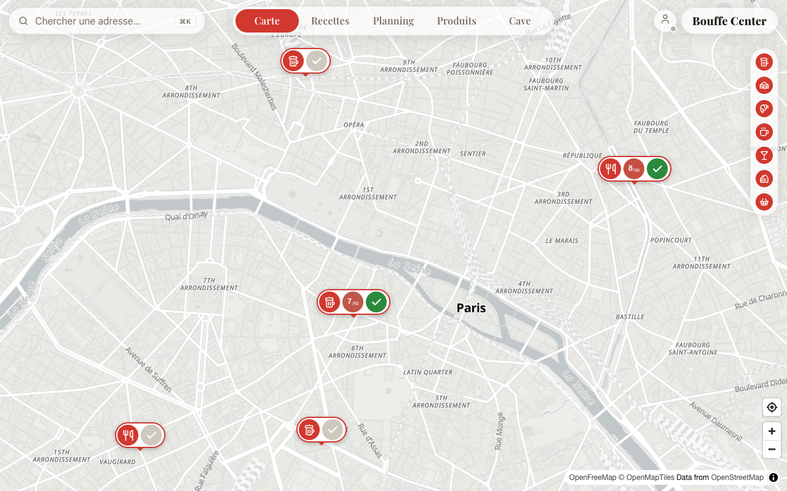

# Bouffe Center

*[English version](README.md)*

Une petite application auto-hébergée pour partager entre amis : une carte des bonnes adresses notées sur 10, des recettes maison, un planning des menus de la semaine (optionnel), et les produits et vins que l'on recommande, avec le stock de la maison. Légère, API-first, mobile-first, et un seul conteneur à déployer.



> L'interface et les messages de l'API sont en **français**. Le code, les commentaires et le README principal sont en anglais.

## Fonctionnalités

- **Carte des adresses** (dans l'esprit de Mapstr) : restaurants, bistrots, boulangeries… notés de 1 à 10 par chaque membre, avec avis, photos créditées à leur auteur, catégories, tags, gamme de prix et infos pratiques. Filtre par catégorie dans la barre latérale, recherche avec ⌘K / Ctrl+K ou `/`, et marquage « déjà testé ».
- **Recettes** en cards (photo, description, tags), avec ingrédients et préparation rédigée dans un éditeur par blocs façon Notion (sortie Markdown).
- **Planning des menus** : du lundi au dimanche, matin / midi / soir, une ou plusieurs recettes par case. Les membres y ont aussi une **liste de courses** : les produits à 0 liés aux recettes de la semaine.
- **Produits** (section optionnelle, active par défaut) : les produits que l'on recommande (marque, photo, où l'acheter, prix, catégorie, tags) avec un **stock commun** en nombre entier. Les membres ne voient par défaut que ce qui est en stock (« Afficher tout » ou une recherche montre le reste) et ajustent les quantités avec des boutons −/+. Les visiteurs voient les recommandations, jamais le stock. Affichage en cards ou en liste. Préremplissage depuis [Open Food Facts](https://fr.openfoodfacts.org/) par le nom ou en **scannant le code-barres** avec l'appareil photo du téléphone.
- **Cave** (section optionnelle, active par défaut) : vins, spiritueux et autres alcools, avec type, millésime, appellation, région, cépages, degré, période de dégustation, prix d'achat et emplacement (ces deux derniers pour les membres). Préremplissage facultatif depuis la base [GrapeMinds](https://grapeminds.eu/fr/api-vin) une fois qu'un admin a enregistré une clé API.
- **Brouillons de recettes avec Ollama** (facultatif) : une fois qu'un admin a branché un serveur [Ollama](https://ollama.com) (Admin > Paramètres : adresse, modèle, jeton facultatif), les membres décrivent un plat en quelques mots et l'éditeur de recette est prérempli (titre, description, ingrédients, étapes, tags, catégorie). Rien n'est enregistré avant leur relecture.
- **Liens** : une recette affiche ses produits conseillés et ses accords mets-vins (avec un repère de stock pour les membres) ; un produit affiche les recettes qui l'utilisent. La recherche ⌘K de la carte et des recettes montre aussi les produits liés.
- **Back-office** sur `/admin` pour les membres (sur invitation, rôle `admin` ou `editor`) : adresses, recettes, photos, catégories, membres, clés API personnelles, paramètres, sauvegarde et restauration complètes.
- **Site public en lecture seule** : carte, fiches, avis, recettes et planning sont visibles sans compte. Dans Admin › Paramètres, un admin peut rendre chaque section (carte, recettes, planning, produits, cave) **privée** : les visiteurs voient alors un écran « Section réservée aux membres » avec un bouton de connexion, et l'API leur répond `401`. Par défaut, tout est public.
- **Ajout rapide** depuis la carte (`N`) : recherche d'un lieu via [Photon](https://photon.komoot.io/) (OpenStreetMap), catégorie, note, c'est fait. Le même bouton `+` (et `N`) sur Produits et Cave ajoute un produit ou un vin (recherche ou scan, nom, catégorie, stock).

## Stack

| Partie | Technologie |
| --- | --- |
| API | [Hono](https://hono.dev/), TypeScript exécuté nativement par Node ≥ 24 (sans build) |
| Base | SQLite via `node:sqlite` (aucune dépendance native), migrations versionnées |
| Images | [sharp](https://sharp.pixelplumbing.com/) : deux WebP par photo, EXIF supprimées |
| Web | [Astro](https://astro.build/) SSR + îlots [Svelte 5](https://svelte.dev/) |
| Carte | [MapLibre GL](https://maplibre.org/) avec les tuiles [OpenFreeMap](https://openfreemap.org/) |
| Éditeur | [Tiptap](https://tiptap.dev/) (back-office uniquement) |

Tout tourne dans **un seul process Node** (environ 65 Mo de RAM au repos) : `/api` et `/uploads` vont à Hono, le reste au handler Astro SSR. Les données tiennent dans un seul dossier (`DATA_DIR`) : la base SQLite et les images. Sauvegarder ce dossier suffit.

## Démarrage

Prérequis : **Node.js ≥ 24**.

```bash
npm install
cp .env.example .env     # renseigne ADMIN_EMAIL / ADMIN_PASSWORD
npm run dev
```

- Site : http://localhost:4321 (carte), `/recettes`, `/planning`, `/produits`, `/cave`, `/admin`
- API : http://localhost:3000/api

Au premier démarrage, le compte admin défini dans `.env` est créé et une base vide reçoit le contenu par défaut (voir plus bas). Les données sont dans `./data`.

### Scripts

```bash
npm run dev        # API sur :3000 + serveur de dev Astro sur :4321 (proxy /api et /uploads)
npm run build      # build du site (web/dist)
npm start          # mode production : tout sur :3000
npm run check      # typecheck du serveur
npm run user:create -w server -- <email> <pseudo> <password> [admin|editor]
npm run seed -w server   # ajoute le contenu par défaut (idempotent)
docker compose up --build   # image de prod en local
```

### Configuration

| Variable | Défaut | Description |
| --- | --- | --- |
| `PUBLIC_URL` | `http://localhost:4321` | URL publique du site. Sert aux liens d'invitation ; le `https` active les cookies sécurisés. **Obligatoire en production.** |
| `ADMIN_EMAIL`, `ADMIN_PASSWORD`, `ADMIN_PSEUDO` | — / — / `admin` | Premier compte admin, créé seulement tant que la base n'a aucun utilisateur. |
| `PORT` | `3000` | Port HTTP. |
| `DATA_DIR` | `./data` (`/data` en Docker) | Base SQLite et images uploadées. |
| `MAX_UPLOAD_MB` | `15` | Taille max d'une photo. |
| `MAX_RESTORE_MB` | `4096` | Taille max d'une sauvegarde à restaurer. |
| `CORS_ORIGINS` | — | Origines (séparées par des virgules) autorisées à appeler l'API avec cookies. |
| `SEED_ON_EMPTY` | `true` | `false` pour démarrer avec une base vide. |

## Déploiement

Le dépôt fournit un `Dockerfile` (port `3000`, volume `/data`, healthcheck sur `/api/health`) et un `docker-compose.yml`. N'importe quel hôte Docker convient ; voici la configuration [Coolify](https://coolify.io/) :

1. **New Resource → Application**, choisis le dépôt et le build pack **Dockerfile**.
2. **Port exposé** : `3000`.
3. **Persistent Storage** : un volume monté sur **`/data`**. Il contient la base et les images : c'est la seule chose à sauvegarder.
4. **Variables d'environnement** : `PUBLIC_URL=https://ton-domaine.fr`, plus `ADMIN_EMAIL`, `ADMIN_PASSWORD` et `ADMIN_PSEUDO` pour le premier admin.
5. Renseigne le domaine, puis **Deploy**.

Le build pack **Docker Compose** fonctionne aussi : `docker-compose.yml` déclare déjà le volume.

### Sauvegardes

Depuis **Admin › Paramètres**, un admin télécharge une sauvegarde complète (`.tar.gz` : base + photos) ou en restaure une. On peut automatiser l'export avec une clé API admin :

```bash
curl -H "Authorization: Bearer bc_…" -o sauvegarde.tar.gz https://ton-domaine.fr/api/backup
```

La restauration demande une session (pas de clé API), met à niveau une sauvegarde plus ancienne et déconnecte tout le monde. Les réglages d'intégration (clé GrapeMinds, connexion Ollama) ne font jamais partie d'une sauvegarde : une restauration conserve ceux du serveur.

## Membres

Va dans `/admin` → **Membres** → **Inviter**, puis envoie le lien généré (valable 7 jours). La personne y choisit son mot de passe.

## API

Le site n'est qu'un client de l'API REST `/api` ; une app mobile et un serveur MCP viendront s'y brancher. `GET /api` liste les endpoints. Les réponses sont en JSON, et les erreurs ont la forme `{ "error": "message" }`.

**Authentification** : le site utilise un cookie de session. Les autres clients envoient `Authorization: Bearer <token>`, avec le token renvoyé par `POST /api/auth/login` ou une clé API personnelle (`bc_…`) créée dans **Mon compte**. Une clé a les droits de son propriétaire, n'est affichée qu'une fois et n'est stockée que sous forme d'empreinte SHA-256.

La liste détaillée des routes est dans le [README anglais](README.md#api).

## Contenu par défaut et crédits

Une base vide reçoit automatiquement trois recettes (bœuf bourguignon, purée façon Robuchon, moelleux au chocolat) et trois brasseries parisiennes (Mollard, La Coupole, Lipp). Les recettes sont rédigées avec nos propres mots. Les photos viennent de [Wikimedia Commons](https://commons.wikimedia.org/) sous licence libre (domaine public, CC0, CC BY, CC BY-SA) ; chacune est créditée à son auteur dans l'app et dans [`server/seed/data.json`](server/seed/data.json). Elles gardent leur licence d'origine et ne sont pas couvertes par la licence du projet.

Pour appliquer ce contenu à une base existante : `npm run seed -w server` (rien n'est dupliqué ni écrasé).

Données cartographiques © contributeurs [OpenStreetMap](https://www.openstreetmap.org/copyright), tuiles [OpenFreeMap](https://openfreemap.org/). Données produits et photos importées : [Open Food Facts](https://fr.openfoodfacts.org/) (ODbL, photos CC BY-SA, créditées dans l'app). Icônes [Lucide](https://lucide.dev/). Police [Playfair Display](https://fonts.google.com/specimen/Playfair+Display) (SIL Open Font License).

## Licence

[MIT](LICENSE)
