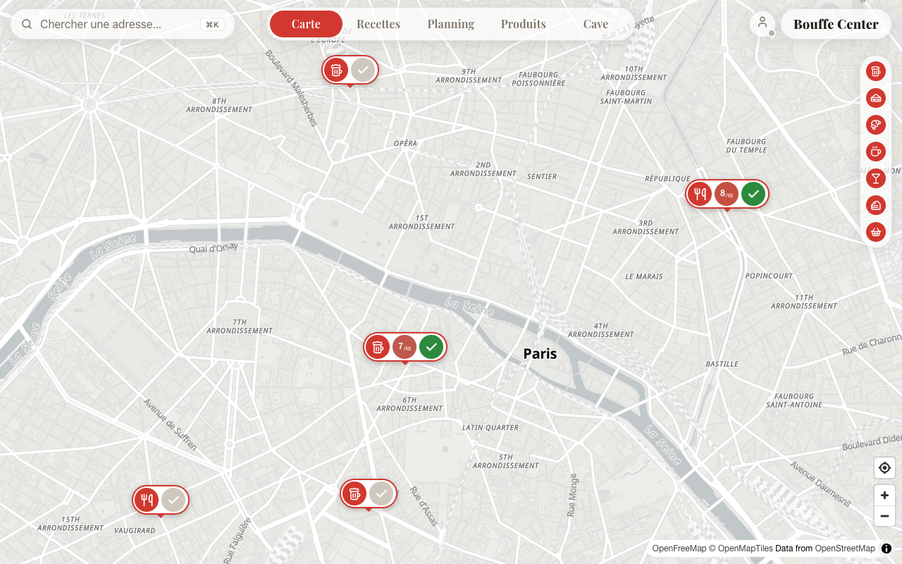

# Bouffe Center

*[Version française](README.fr.md)*

A small, self-hosted app to share good food with friends: a map of favourite places rated out of 10, home-made recipes, an optional weekly meal planner, and the products and wines we recommend, with the household stock. Lightweight, API-first, mobile-first, and a single container to deploy.



> **Language:** the interface and API messages are in **French** (it is the app's default and only language for now). The code, comments and this README are in English.

## Features

- **Map of places** (in the spirit of Mapstr): restaurants, bistros, bakeries… with a 1–10 rating per member, reviews, photos credited to their author, categories, tags, price range and practical info. Filter by category from the side rail, search with ⌘K / Ctrl+K or `/`, and mark places as "already tried".
- **Recipes** shown as cards (photo, description, tags), with ingredients and steps written in a Notion-like block editor (Markdown output).
- **Weekly meal planner**: Monday to Sunday, breakfast / lunch / dinner, one or more recipes per slot. Members also get a **shopping list**: out-of-stock products linked to the week's recipes.
- **Products** (optional section, on by default): products we recommend (brand, photo, where to buy, price, category, tags) with a shared **household stock** in whole numbers. Members only see what is in stock by default ("Afficher tout" or a search shows the rest), and adjust quantities with −/+ buttons. Visitors see the recommendations, never the stock. Cards or list view. Products can be prefilled from [Open Food Facts](https://world.openfoodfacts.org/) by name or by **scanning the barcode** with the phone's camera.
- **Cellar** (optional section, on by default): wines, spirits and other drinks, with type, vintage, appellation, region, grapes, ABV, drinking window, purchase price and location (the last two for members only). Optionally prefilled from the [GrapeMinds](https://grapeminds.eu/fr/api-vin) wine database once an admin saves an API key.
- **Recipe drafts with Ollama** (optional): once an admin connects an [Ollama](https://ollama.com) server (Admin > Settings: address, model, optional token), members describe a dish in a few words and the recipe editor is prefilled (title, description, ingredients, steps, tags, category). Nothing is saved before they review it.
- **Links**: a recipe lists its recommended products and wine pairings (with an in-stock mark for members); a product lists the recipes it is used in. The ⌘K search on the map and the recipes also shows related products.
- **Back-office** at `/admin` for members (invite-only, `admin` or `editor` role): places, recipes, photos, categories, members, personal API keys, settings, and full backup / restore.
- **Public read-only site**: map, place pages, reviews, recipes and planning are visible without an account. In Admin › Paramètres, an admin can make each section (map, recipes, planning, products, cellar) **private**: visitors then see a "members only" screen with a sign-in button, and the API answers `401`. Everything is public by default.
- **Quick add** from the map (`N`): search a place via [Photon](https://photon.komoot.io/) (OpenStreetMap), pick a category, rate it, done. The same `+` button (and `N`) on Produits and Cave adds a product or a wine (lookup or barcode scan, name, category, stock).

## Stack

| Part | Technology |
| --- | --- |
| API | [Hono](https://hono.dev/), TypeScript run natively by Node ≥ 24 (no build step) |
| Database | SQLite through `node:sqlite` (no native dependency), versioned migrations |
| Images | [sharp](https://sharp.pixelplumbing.com/): two WebP renditions per photo, EXIF stripped |
| Web | [Astro](https://astro.build/) SSR + [Svelte 5](https://svelte.dev/) islands |
| Map | [MapLibre GL](https://maplibre.org/) with [OpenFreeMap](https://openfreemap.org/) tiles |
| Editor | [Tiptap](https://tiptap.dev/) (back-office only) |

Everything runs in **one Node process** (about 65 MB of RAM at rest): `/api` and `/uploads` go to Hono, every other request to the Astro SSR handler. Data lives in a single directory (`DATA_DIR`): the SQLite database and the uploaded images. Backing up that directory is enough.

## Getting started

Requirements: **Node.js ≥ 24**.

```bash
npm install
cp .env.example .env     # set ADMIN_EMAIL / ADMIN_PASSWORD
npm run dev
```

- Website: http://localhost:4321 (map), `/recettes` (recipes), `/planning`, `/produits`, `/cave`, `/admin`
- API: http://localhost:3000/api

On first start, the admin account defined in `.env` is created and an empty database receives some default content (see below). Data is stored in `./data`.

### Scripts

```bash
npm run dev        # API on :3000 + Astro dev server on :4321 (proxies /api and /uploads)
npm run build      # build the website (web/dist)
npm start          # production mode: everything on :3000
npm run check      # typecheck the server
npm run user:create -w server -- <email> <pseudo> <password> [admin|editor]
npm run seed -w server   # add the default content (idempotent)
docker compose up --build   # run the production image locally
```

### Configuration

| Variable | Default | Description |
| --- | --- | --- |
| `PUBLIC_URL` | `http://localhost:4321` | Public URL of the site. Used in invitation links; `https` enables secure cookies. **Required in production.** |
| `ADMIN_EMAIL`, `ADMIN_PASSWORD`, `ADMIN_PSEUDO` | — / — / `admin` | First admin account, created only while the database has no user. |
| `PORT` | `3000` | HTTP port. |
| `DATA_DIR` | `./data` (`/data` in Docker) | SQLite database and uploaded images. |
| `MAX_UPLOAD_MB` | `15` | Maximum size of an uploaded photo. |
| `MAX_RESTORE_MB` | `4096` | Maximum size of a backup to restore. |
| `CORS_ORIGINS` | — | Comma-separated origins allowed to call the API with cookies. |
| `SEED_ON_EMPTY` | `true` | Set to `false` to start with an empty database. |

## Deployment

The repository ships a `Dockerfile` (port `3000`, volume `/data`, healthcheck on `/api/health`) and a `docker-compose.yml`. Any Docker host works; here is the [Coolify](https://coolify.io/) setup:

1. **New Resource → Application**, pick the repository and the **Dockerfile** build pack.
2. **Exposed port**: `3000`.
3. **Persistent storage**: mount a volume on **`/data`**. It holds the database and the images: it is the only thing to back up.
4. **Environment variables**: `PUBLIC_URL=https://your-domain.example`, plus `ADMIN_EMAIL`, `ADMIN_PASSWORD` and `ADMIN_PSEUDO` for the first admin.
5. Set the domain, then **Deploy**.

The **Docker Compose** build pack works too: `docker-compose.yml` already declares the volume.

### Backups

From **Admin › Paramètres**, an admin can download a full backup (`.tar.gz`: database + photos) or restore one. Backups can be automated with an admin API key:

```bash
curl -H "Authorization: Bearer bc_…" -o backup.tar.gz https://your-domain.example/api/backup
```

Restoring requires a signed-in session (not an API key), upgrades older backups to the current schema, and signs every user out. Integration settings (GrapeMinds key, Ollama connection) are never part of a backup: a restore keeps the server's own.

## Members

Go to `/admin` → **Membres** → **Inviter** and send the generated link (valid for 7 days). The new member chooses their password there.

## API

The website is just one client of the REST API under `/api`; a mobile app and an MCP server are planned on top of it. `GET /api` lists the endpoints. Responses are JSON, and errors look like `{ "error": "message" }` (messages in French).

**Authentication:** the website uses a session cookie. Other clients send `Authorization: Bearer <token>`, with either the token returned by `POST /api/auth/login` or a personal API key (`bc_…`) created in **Mon compte**. An API key has its owner's permissions, is shown only once, and is stored as a SHA-256 hash.

| Method | Route | Access |
| --- | --- | --- |
| GET | `/api/places/geojson` | public¹: compact GeoJSON for the map |
| GET | `/api/places?q=&category=&tag=` | public¹ (`drafts=true`, `mine=true` when signed in) |
| GET | `/api/places/:idOrSlug` | public¹: place + reviews + photos + linked recipes |
| POST / PATCH / DELETE | `/api/places[/:id]` | member (edit: author or admin) |
| PUT / DELETE | `/api/places/:id/review` | member: own review `{ rating: 1..10, comment }` |
| PUT | `/api/places/:id/tried` | member: `{ tried: true \| false }` |
| GET | `/api/recipes?q=&category=&tag=a,b&limit=&offset=` (several tags: all required) | public¹ |
| GET | `/api/recipes/:idOrSlug` | public¹ (+ linked `products`, with `quantity` for members) |
| POST / PATCH / DELETE | `/api/recipes[/:id]` | member (edit: author or admin) |
| PUT | `/api/recipes/:id/products` `{ product_ids }` | member (author or admin): recommended products and wine pairings |
| GET | `/api/products?kind=pantry\|wine&q=&category=&tag=&in_stock=1&limit=&offset=` | public¹² (no `kind`: every section open to the caller) |
| GET | `/api/products/:idOrSlug` | public¹²: product + photos + recipes it is used in |
| POST / PATCH / DELETE | `/api/products[/:id]` | member (edit: author or admin) |
| PUT | `/api/products/:id/stock` `{ quantity }` or `{ delta }` | member: shared stock, never below 0 |
| GET | `/api/products/lookup?barcode=\|q=` | member: Open Food Facts lookup |
| POST | `/api/products/:id/import-image` `{ url }` | member: imports an Open Food Facts photo |
| GET | `/api/products/wine-lookup?q=`, `/api/products/wine-lookup/:id` | member: GrapeMinds search and sheet (when a key is set) |
| POST | `/api/images` (multipart: `file`, `kind`, `owner_id`) | member |
| PATCH / DELETE | `/api/images/:id`, POST `/api/images/reorder` | member |
| GET | `/api/categories`, `/api/tags?kind=place\|recipe\|product\|wine` | public (tags¹) |
| POST / PATCH / DELETE | `/api/categories[/:id]` `{ name, icon, color, sort, published, applies_to: all\|places\|recipes }` | admin |
| GET | `/api/planning?week=YYYY-MM-DD` | public¹ |
| GET | `/api/planning/shopping?week=YYYY-MM-DD` | member: out-of-stock products linked to the week's recipes |
| PUT | `/api/planning/:date/:meal` `{ recipe_ids }` | member (`meal` = `breakfast` \| `lunch` \| `dinner`) |
| GET / PATCH | `/api/settings` `{ map_private, recipes_private, planning_private, products_private, cellar_private, products_enabled, cellar_enabled }` | public / admin (`GET` also tells `grapeminds_enabled` and `ollama_enabled`) |
| GET / PUT / DELETE | `/api/integrations/grapeminds` `{ api_key }`, POST `/api/integrations/grapeminds/test` | admin (PUT / DELETE: session only); the key is never returned |
| GET / PUT / DELETE | `/api/integrations/ollama` `{ url, model, token? }`, POST `/api/integrations/ollama/test`, POST `/api/integrations/ollama/models` `{ url, token? }` | admin (PUT / DELETE: session only); the token is never returned |
| POST | `/api/recipes/generate` `{ prompt }` | member, when Ollama is connected: returns a draft `{ title, description, ingredients, body, tags, category_id }`, saves nothing |
| GET / POST / PATCH / DELETE | `/api/users[/:id]`, POST `/api/users/:id/invite` | admin |
| POST | `/api/auth/login` → `{ user, token }`, `/api/auth/logout` | public |
| GET / PATCH | `/api/auth/me` | member |
| GET / POST / DELETE | `/api/api-keys[/:id]` | member, session only (admins see every key with `?all=true`) |
| GET / POST | `/api/backup` | admin (restore: session only) |

¹ Unless the section is private (`map_private`, `recipes_private`, `planning_private`, `products_private`, `cellar_private`): visitors then get `401`, members (session or API key) keep full access. A switched-off section (`products_enabled`, `cellar_enabled`) answers `404` to visitors.

² `quantity`, `purchase_price_cents` and `location` are only sent to members; `in_stock=1` is ignored for visitors.

## Project structure

```
server/   Hono API (TypeScript run natively by Node)
  src/routes/   one file per resource
  src/lib/      auth, images, backup, search helpers
  seed/         default content and its images
web/      Astro SSR site + Svelte islands
  src/pages/        map, recipes, planning, products, cellar, admin
  src/components/   map, place panel, recipe and product browsers, barcode scanner…
  src/admin/        back-office (Svelte SPA, Tiptap editor)
data/     (gitignored) SQLite database + uploads; the /data volume in production
```

[CLAUDE.md](CLAUDE.md) (in French) documents the product rules, design choices and conventions in detail.

## Default content and credits

An empty database automatically receives three recipes (bœuf bourguignon, Robuchon-style mashed potatoes, chocolate fondant) and three Paris brasseries (Mollard, La Coupole, Lipp). The recipes are written in our own words. The photos come from [Wikimedia Commons](https://commons.wikimedia.org/) under free licenses (public domain, CC0, CC BY, CC BY-SA); each one is credited to its author in the app and in [`server/seed/data.json`](server/seed/data.json). These photos keep their original licenses and are not covered by this project's license.

To add this content to an existing database, run `npm run seed -w server`: nothing is duplicated or overwritten.

Map data © [OpenStreetMap](https://www.openstreetmap.org/copyright) contributors, tiles by [OpenFreeMap](https://openfreemap.org/). Imported product data and photos: [Open Food Facts](https://world.openfoodfacts.org/) (ODbL, photos CC BY-SA, credited in the app). Icons by [Lucide](https://lucide.dev/). Font: [Playfair Display](https://fonts.google.com/specimen/Playfair+Display) (SIL Open Font License).

## License

[MIT](LICENSE)
